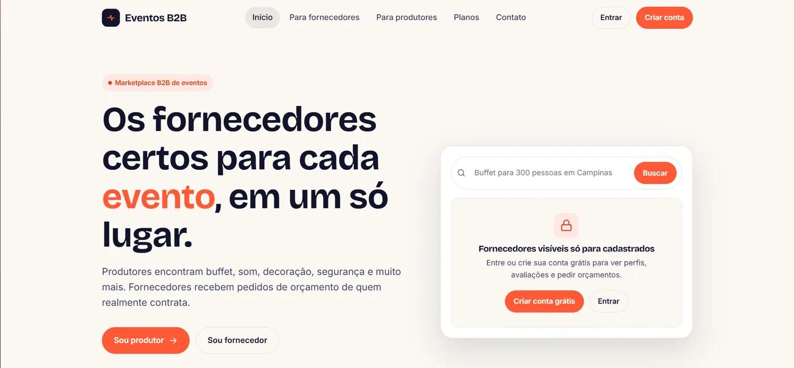

<div align="center">


<sub><a href="./README.md">🇺🇸 English</a> · 🇧🇷 Português</sub>

<br/><br/>


<br/>

<a href="https://www.linkedin.com/in/daniel-stucaluc-devweb-ti/"></a>
<a href="mailto:stucalucsystems@gmail.com"></a>

<br/>

<a href="https://github.com/Stucaluc?tab=followers"></a>

</div>

## Sobre

Desenvolvo sistemas web, APIs REST e automações que eliminam trabalho manual em negócios reais: do levantamento de requisitos com o cliente até a entrega e o suporte pós-implantação.

- **Full Stack** — sistemas de gestão, e-commerces, landing pages e apps mobile (PHP, JavaScript, SQL, React Native)
- **RPA e automação** — 1 ano e meio criando robôs que integram sistemas legados a plataformas modernas
- **IA aplicada** — agentes com uso de ferramentas integrados a fluxos de trabalho reais
- **Formação** — Ciência da Computação (Universidade Brás Cubas) · Defesa Cibernética (FIAP)

**Disponível para:** vagas full stack · projetos freelance · consultoria em automação e RPA

## Projetos em destaque

### 🤖 Nexo — assistente pessoal com IA no WhatsApp
Assistente multimodal (texto, voz e foto) em que um agente de IA com uso de ferramentas executa mais de 70 ações: gastos em várias moedas, lembretes recorrentes, Google Calendar, leitura de notas fiscais por visão computacional e propostas em PDF — sempre pedindo aprovação antes de enviar qualquer coisa.

`Node.js` `PostgreSQL` `Docker` `Evolution API` `Gemini / Anthropic APIs` · retry com backoff, autoteste diário, mais de 80 testes unitários, mitigação de prompt injection

### 🔗 [Encurtador de URL com Analytics](https://github.com/Stucaluc/URL-shortener-com-analytics)
Links curtos com alias personalizado e expiração, mais um painel com cliques, visitantes únicos, origem, navegador, dispositivo e país. Privacidade desde o projeto: nenhum IP é guardado, só um hash HMAC.

`TypeScript` `Fastify` `PostgreSQL` `Chart.js` `Docker` · autenticação por API key, rate limit, validação com Zod, CI com GitHub Actions

### 🎪 Marketplace de Fornecedores para Eventos *(em desenvolvimento)*
Marketplace B2B por assinatura que conecta produtores de eventos e fornecedores: busca por categoria e cidade, portfólios, avaliações e pedidos de orçamento.



### 🐾 Plataforma de gestão para pet shop *(projeto de cliente, privado)*
Fluxo de caixa, agendamentos, estoque e ponto de venda em um só sistema, substituindo processos feitos à mão. `PHP` `JavaScript` `MySQL` `Bootstrap` `API REST`

## Experiência

**Desenvolvedor Full Stack** · Freelancer · jan 2025 – atual
Sistemas web, e-commerces e portais corporativos; APIs REST, gateways de pagamento e integrações externas; MySQL, PostgreSQL e MongoDB.

**Desenvolvedor de Automação (RPA)** · Robotizei Tecnologia · mai 2023 – nov 2024
Automações de processos administrativos e financeiros, robôs integrando sistemas legados a plataformas modernas e levantamento de requisitos com as áreas de negócio.

## Stack

<table>
<tr><td><b>Linguagens</b></td><td></td></tr>
<tr><td><b>Front-end</b></td><td></td></tr>
<tr><td><b>Back-end</b></td><td></td></tr>
<tr><td><b>Bancos de dados</b></td><td></td></tr>
<tr><td><b>Mobile</b></td><td> </td></tr>
<tr><td><b>DevOps e ferramentas</b></td><td></td></tr>
</table>

## Atividade



<picture>
  <source media="(prefers-color-scheme: dark)" srcset="https://raw.githubusercontent.com/stucaluc/stucaluc/output/github-contribution-grid-snake-dark.svg"/>
  <source media="(prefers-color-scheme: light)" srcset="https://raw.githubusercontent.com/stucaluc/stucaluc/output/github-contribution-grid-snake.svg"/>
  
</picture>

<sub>Heatmap e cobrinha gerados todo dia por GitHub Actions deste repositório.</sub>

## Agora

```yaml
construindo: [Nexo, marketplace de fornecedores para eventos, portfólio pessoal]
estudando:   [defesa cibernética na FIAP, fundamentos de computação, agentes de IA]
explorando:  [IA para produtividade no desenvolvimento, servidores e infraestrutura]
```
